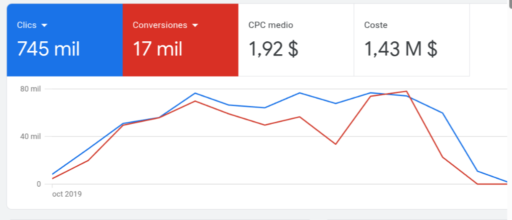
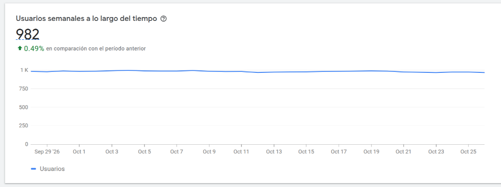
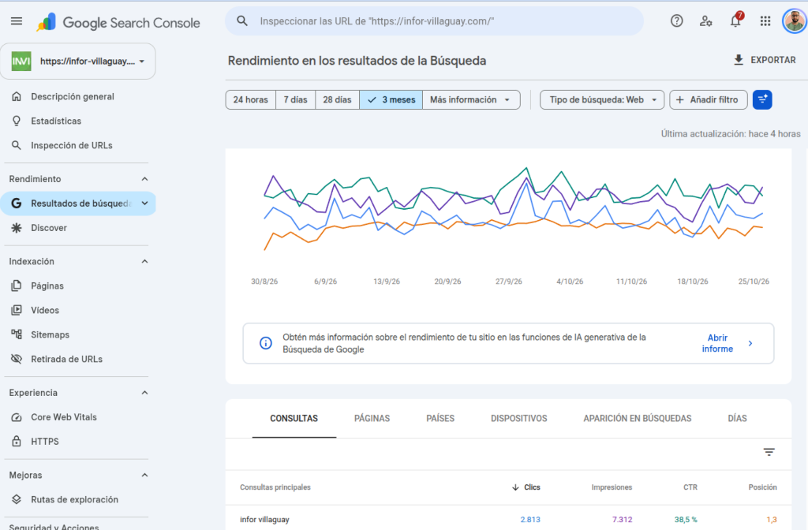

# Hola, soy [Juan Monzón](https://www.linkedin.com/in/juan-m-97b85681/) 👋

**Full Stack Developer & Digital Product Builder | AI, Growth & Conversion Engineering**  
📍 Argentina

  
  
  
  
  
  
  

---

### 🚀 Sobre mí / About Me

Soy **Full Stack Developer y creador de productos digitales**, con más de **9 años de experiencia** construyendo, desplegando y monetizando software en producción. Combino desarrollo de software, IA aplicada, diseño de producto y visión de negocio para transformar ideas desde su concepción hasta soluciones operativas, escalables y rentables.

Me apasiona crear, automatizar y escalar productos digitales conectando la **adquisición de usuarios** con la **experiencia de producto (PX)** y la **conversión**, tomando decisiones fundamentadas en datos, métricas y resultados medibles.

> 🇬🇧 *Full Stack Developer and Digital Product Builder with 9+ years of experience engineering, deploying, and monetizing software. I bridge software engineering, applied AI, and user acquisition with product experience (PX) and conversion rate optimization (CRO) to turn concepts into profitable, scalable production platforms.*

---

### 🧠 Filosofía de Producto: SDLC + Psicología del Diseño & Funnels (CRO)

Mi desarrollo no se limita al ciclo de vida tradicional del software (**SDLC**) o metodologías **LEAN / Agile**. Cada interfaz, flujo y arquitectura está construida integrando **Leyes de UX/UI y Psicología del Diseño** orientadas a optimizar el embudo de conversión (*Marketing Funnel*):

- **Leyes de UX/UI aplicadas a la reducción de fricción:**
  - **Ley de Hick:** Reducción drástica del esfuerzo cognitivo y fatiga de decisión al simplificar las opciones del usuario en cada paso.
  - **Ley de Fitts:** Jerarquía ergonómica y accesibilidad inmediata en botones de acción principales y llamadas a la acción (CTAs).
  - **Efecto Von Restorff (Aislamiento):** Resalte visual y de contraste del elemento crítico de conversión para guiar la atención sin distracciones.
  - **Ley de Proximidad:** Estructuración visual lógica de propuestas de valor, tablas comparativas y modelos de precios.
- **Gatillos Mentales (*Psychological Triggers*) y Sesgos Cognitivos:**
  - **Ganchos (*Hooks*):** Retención inmediata en los primeros 3 segundos mediante copy estratégico y estímulos visuales de alto impacto.
  - **Validación Social (*Social Proof*):** Integración orgánica de testimonios, métricas de uso y prueba de satisfacción para derribar objeciones.
  - **Escasez y Urgencia (*FOMO - Fear Of Missing Out*):** Dinámicas contextualizadas de disponibilidad y tiempos limitados que incentivan la acción inmediata.
  - **Framework AIDA (Atención, Interés, Deseo, Acción):** Estructura persuasiva aplicada en landing pages, microcopias, onboardings y pasarelas de pago.

---

### 📊 Adquisición, Performance & Analítica (Search Ads, Technical SEO & Data)

Conecto la ingeniería con la tracción real del producto mediante una gestión analítica rigurosa:

- **Google Ads (Search):** Especialización y dominio exclusivo de **campañas de búsqueda en Google Ads (Search Ads)**, optimizando la intención de compra del usuario, pujas estratégicas y análisis competitivo de anuncios para captar tráfico calificado con alto retorno de inversión.
  - 📈 **Track Record en SaaS de Geolocalización (2019 - 2022):** Campañas de búsqueda a gran escala para variantes y micro-servicios SaaS predecesores de PuntoGeo, logrando **+745.000 clics**, **+17.000 conversiones directas** y liderazgo continuo en el ranking de búsqueda en un nicho altamente competitivo.

  

- **Technical SEO & Core Web Vitals:**
  - Arquitectura de metadatos estructurados enriquecidos (**Schema.org / JSON-LD**).
  - Optimización extrema de velocidad de carga y métricas Core Web Vitals (**LCP, INP, CLS, FCP**) con altos puntajes en Google Dev Speed Score / PageSpeed Insights.
  - Investigación exhaustiva de palabras clave de cola corta y cola larga (*short & long-tail*), mapeo de intención de búsqueda y análisis de autoridad, fuerza de dominio y perfil de backlinks.
- **Email Marketing & Automatización:** Secuencias automatizadas de onboarding, retención y reactivación orientadas a LTV.
- **Analítica Cuantitativa y Cualitativa:** Monitoreo y optimización continua del comportamiento del usuario utilizando **Google Analytics 4 (GA4)**, **Google Tag Manager (GTM)**, **Microsoft Clarity** y **Hotjar** (grabaciones de sesión, heatmaps y análisis de abandono).

---

### 🧩 Productos Digitales, Plataformas SaaS y Aportes Open-Source

- 🚀 **[Anuncero — `anuncero.press`](https://anuncero.press)** *(En desarrollo activo)*  
  **Infraestructura tecnológica publicitaria.** Conectamos medios y anunciantes mediante tecnología de autoservicio (*self-serve AdTech*), diseñada para transformar y simplificar la forma en que se compra y vende publicidad digital.

- 📍 **[PuntoGeo — `puntogeo.com`](https://puntogeo.com)** *(SaaS en producción · Licencia comercial disponible)*  
  **Plataforma de localización GPS vía SMS para familia y amigos.** Pensada para situaciones cotidianas de asistencia y tranquilidad en ruta (como acompañar el trayecto de un hijo, hija o familiar a distancia cuando otras herramientas o apps de mensajería no funcionan).  
  - **Consentimiento bilateral y trazabilidad legal:** Opera exclusivamente bajo aceptación expresa de ambas partes, registrando la conformidad de los Términos y Condiciones legales antes de compartir cualquier ubicación (uso estrictamente lícito; la plataforma deslinda toda responsabilidad ante usos indebidos).  
  - **Modelo y Arquitectura (*Turnkey SaaS*):** Sistema accesible basado en créditos prepagos de bajo costo. Construido con **Supabase**, optimizado para despliegue en **Vercel** o autoalojado en **VPS mediante Docker**.  
  - 💼 **Adquisición de código fuente / SaaS completo:** Repositorio privado disponible bajo licencia comercial llave en mano por **USD $1,500** (consultas vía [LinkedIn](https://www.linkedin.com/in/juan-m-97b85681/) o `mylnzon58@gmail.com`).

- ⚡ **[LiveFunnel — `mylnzon58/livefunnel`](https://github.com/mylnzon58/livefunnel)** *(Open Source · Apache 2.0)*  
  **Motor de embudos de conversión (CRO) en tiempo real, globo 3D interactivo y trazabilidad forense de sesiones para Next.js & Supabase.** Permite visualizar actividad global en vivo sin depender de APIs externas de mapas, auditar el recorrido paso a paso de cada usuario antes de comprar o abandonar, medir ingresos (pago único o suscripciones) y proteger la cuota gratuita (*Free Tier*) mediante agregación SQL directa en PostgreSQL.

- 🌐 **[Extensión de Texto a Voz (TTS) en Chrome Web Store](https://chromewebstore.google.com/detail/ofiokicamkblihcegnjnjngfooehhgfk?utm_source=item-share-cb)** *(100% Gratuita · ~1.000 Usuarios Activos Semanales)*  
  **Convierte cualquier texto seleccionado de páginas web en audio al instante.** Diseñada para profesionales y estudiantes que necesitan ahorrar tiempo y hacer multitarea escuchando artículos, noticias, documentación o fragmentos marcados mientras realizan otras actividades.  
  - 📈 **Tracción y adopción:** Base sólida y sostenida de **casi 1.000 usuarios activos semanales (~982 WAU)** con alta retención en el panel oficial de desarrolladores de Google.  
  - ⭐ **Pruébala gratis:** [Instalar desde Chrome Web Store](https://chromewebstore.google.com/detail/ofiokicamkblihcegnjnjngfooehhgfk?utm_source=item-share-cb) y déjame tu calificación o reseña de 5 estrellas si te ayuda en tu día a día.

  

- 🛠️ **[t2-macbook-pro-16-1-dsp-ubuntu-24.04](https://github.com/mylnzon58/t2-macbook-pro-16-1-dsp-ubuntu-24.04)** *(Aporte Open-Source)*  
  Diagnóstico, parche y automatización del grafo DSP de 6 canales (PipeWire 1.0.7 + LV2 + FIR Convolver) para MacBook Pro 16,1 (2019, A2141) en Ubuntu 24.04 LTS.  
  📄 [Documentación Técnica (GitHub Pages)](https://mylnzon58.github.io/t2-macbook-pro-16-1-dsp-ubuntu-24.04/)

---

### 🛡️ Caso Real: Seguridad Web, Hardening en WordPress & SEO (+10 años en producción)

Además de crear nuevos productos y plataformas SaaS, administro y optimizo infraestructura web con alta demanda y longevidad en producción:

- **Portal de Noticias (`infor-villaguay.com` — Creado y administrado continuamente desde 2014):**
  - **Mantenimiento Crítico & Seguridad:** Más de una década administrando el sitio; mitigación de ataques de fuerza bruta, bloqueo de bots maliciosos que explotaban vulnerabilidades en plugins y desinfección forense de inyecciones de malware en bases de datos.
  - **Modernización de Infraestructura:** Actualizaciones continuas del stack tecnológico, incluyendo la migración a versiones recientes de **PHP** para maximizar rendimiento, estabilidad y velocidad de respuesta.
  - **Resultados de SEO Orgánico (Google Search Console):** Posicionamiento líder en búsquedas clave locales con una **posición media de 1,3** y un **CTR superior al 38%**, logrando miles de clics orgánicos mensuales sin depender de pauta publicitaria.

  

---

### ☕ ¿Te sirvió alguna de mis herramientas o soluciones? / Support My Work

Si alguna de mis herramientas, extensiones o soluciones *open-source* que comparto por aquí te ayudó a resolver un problema o te ahorró horas de trabajo, puedes invitarme un **Tecito** si deseas apoyar mis proyectos:

👉 **[☕ Invitame un Tecito en https://tecito.app/juanjoclassic](https://tecito.app/juanjoclassic)**
