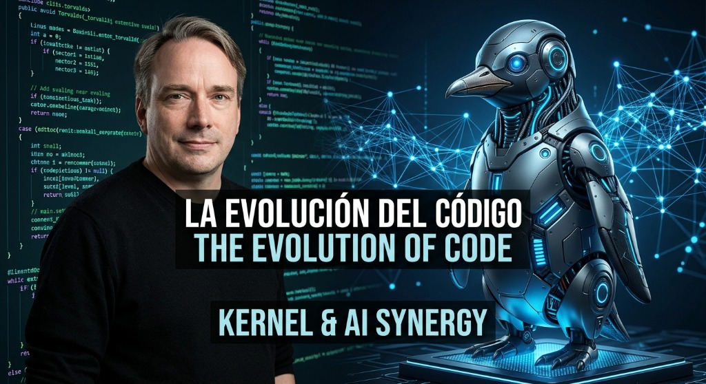

# La Evolución del Código: Sinergia entre Kernel, C/Assembler y la Inteligencia Artificial

  

> *«Linux no es uno de esos proyectos anti-IA y, si alguien tiene problemas con eso, puede hacer lo propio del código abierto y crear un fork. O simplemente marcharse. La IA es una herramienta, igual que otras herramientas que usamos. Y está claro que es útil».*  
> — **Linus Torvalds**

---

Estas contundentes palabras del creador de Linux exponen una realidad incómoda en el ecosistema del software libre: **la resistencia al cambio impulsada por el ego**.

Durante décadas, el desarrollo a bajo nivel —la arquitectura de drivers, la inspección de volcados de registros en **Assembler (x86_64)**, el seguimiento de buffers y colas de trabajo en **C**, los puentes criptográficos con chips de seguridad en **Rust** o el diseño de grafos de audio **DSP**— estuvo rodeado de una barrera elitista y dogmática. En muchas comunidades de mantenimiento, parece preferirse frenar el avance comunitario o descartar reportes antes que dar el brazo a torcer ante una solución externa.

### ¿El motivo de fondo?

A muchos les incomoda que hoy un desarrollador o creador de producto, con bases sólidas de programación y lógica apalancadas por una Inteligencia Artificial bien dirigida, sea capaz de encontrar, auditar y corregir cuellos de botella de hardware que a especialistas dedicados se les pasaron por alto durante años.

En lugar de abrazar el progreso, a menudo se responde con hostilidad o escepticismo infundado, rechazando cambios que son técnicamente lógicos, estables y comprobados en silicio real.

Como bien dice Linus Torvalds:  
> *«Cualquiera que dude de que la IA es útil, claramente no la ha usado en la realidad».*

---

### La Democratización del Conocimiento Profundo

La Inteligencia Artificial ha venido a democratizar el acceso a la alta ingeniería:

1. **Comprensión Acelerada:** Permite formular hipótesis rápidas sobre el comportamiento de controladores del kernel, registros ACPI y especificaciones de silicio sin necesidad de décadas de burocracia académica.
2. **Sinergia Humano + IA:** La IA no sustituye el criterio ni la visión de producto; es un multiplicador cognitivo para quienes entienden qué buscar, cómo verificarlo y cómo empaquetarlo para el usuario final.
3. **El Valor Está en la Solución:** La tecnología avanza para quienes la utilizan como herramienta de construcción, no para quienes la perciben como una amenaza a su estatus en un foro.

Linux y el código abierto son demasiado grandes para quedarse estancados en el orgullo de unos pocos. El futuro pertenece a las herramientas que resuelven problemas reales.

---

*Publicado por [Juan José Monzón (@mylnzon58)](https://github.com/mylnzon58) · AI Product Builder & Full Stack Developer*

`#Linux` `#OpenSource` `#IA` `#ArtificialIntelligence` `#SoftwareDevelopment` `#Kernel` `#Tecnologia` `#Productividad`
